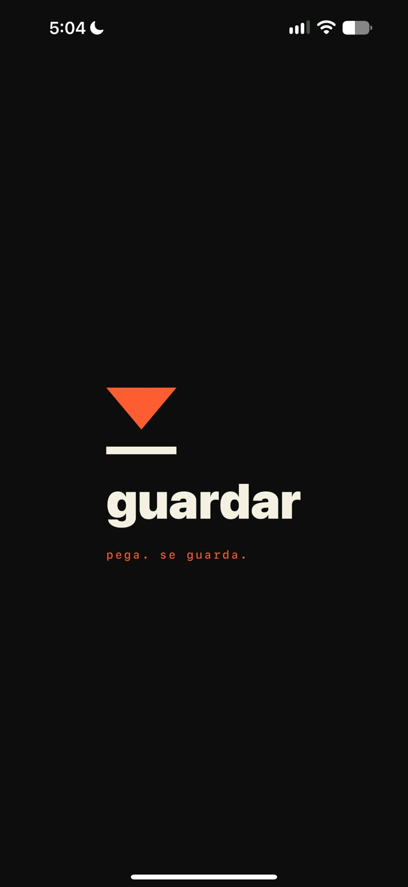
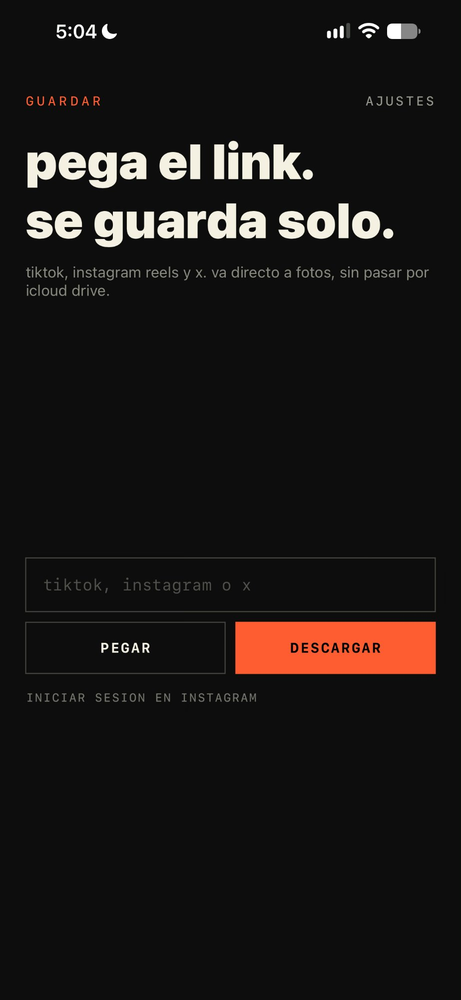
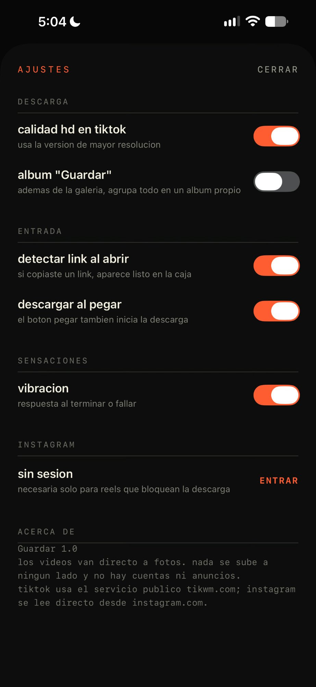

# guardar

app de iphone para bajar videos de tiktok, reels de instagram y videos de x pegando solo el link. el archivo se guarda directo en fotos, sin pasar por icloud drive ni por la app archivos.

<p>
  
  
  
</p>

## que hace

- pega el link (o lo detecta del portapapeles al abrir) y se guarda en fotos
- tiktok en hd y sin marca de agua, fotos de carruseles incluidas
- reels de instagram sin cuenta; para los que bloquean la descarga se puede iniciar sesion dentro de la app
- videos, gif y fotos de tweets de x
- album propio opcional, vibracion y deteccion de portapapeles configurables
- swiftui puro, sin dependencias, ios 17 o superior

## como funciona

| origen | metodo |
| --- | --- |
| tiktok | servicio publico tikwm.com |
| instagram | pagina embebida del reel; si el embed esta bloqueado, la sesion del propio usuario |
| x | api publica de fxtwitter |

la sesion de instagram vive solo en el almacen de la app y se borra desde ajustes. nada se envia a servidores propios: no existen.

## compilar

```bash
brew install xcodegen
TEAM_ID=TU_TEAM_ID xcodegen generate
open Guardar.xcodeproj
```

con una cuenta gratuita de apple la firma caduca a los 7 dias y el limite es de 3 apps de desarrollo por dispositivo.

## limites

- los tres origenes son externos y pueden cambiar sin aviso; si algo deja de funcionar, lo mas probable es el parser de ese origen
- no descarga cuentas privadas
- pensada para uso personal; respeta los derechos de quien creo el contenido
